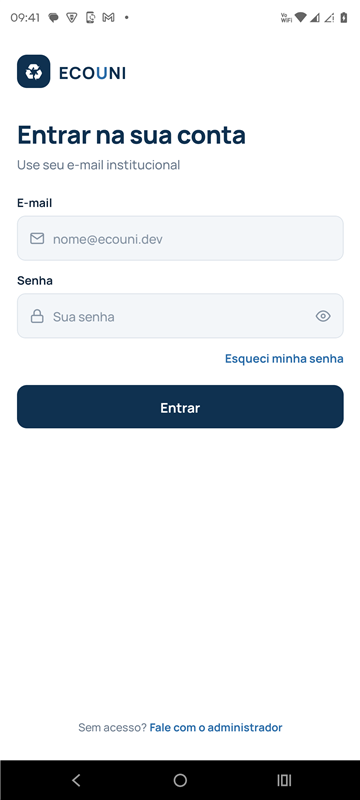
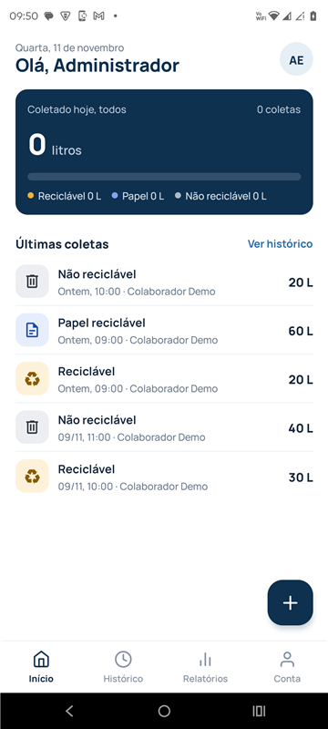
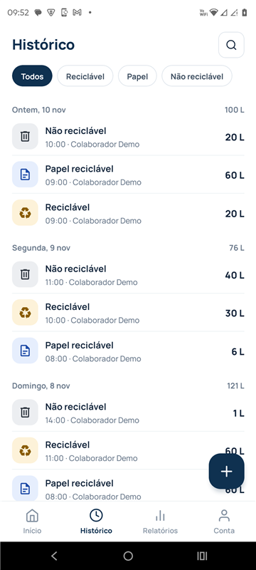
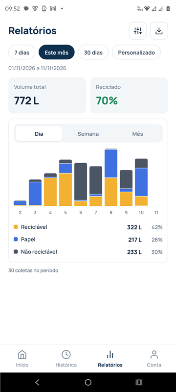
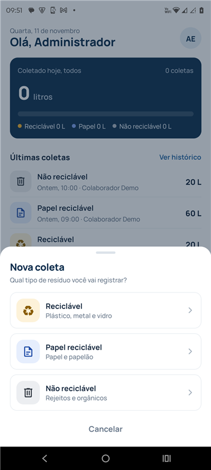
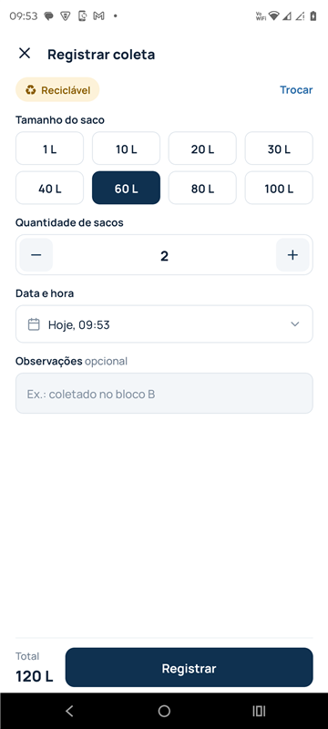
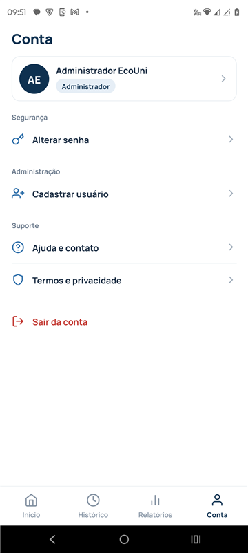
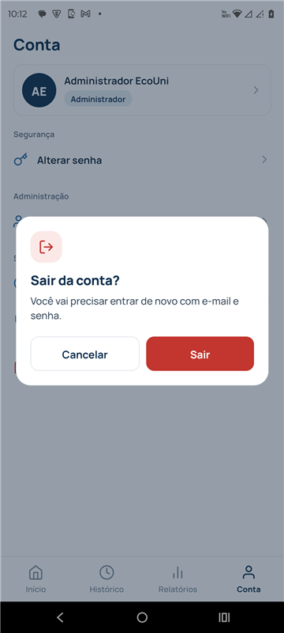

# EcoUni

App mobile para registrar e acompanhar a coleta de resíduos de um campus universitário. Colaboradores registram cada saco coletado por tipo de resíduo, e o administrador acompanha os volumes em relatórios e exporta PDFs.

Projeto de Conclusão de Curso do **Centro Universitário UNIFAAT**, revisado e redesenhado depois da entrega. A API fica no repositório [Ecouni_Projeto](https://github.com/kaiquedu/Ecouni_Projeto).

<p>
  
  
  
  
</p>
<p>
  
  
  
  
</p>

## Funcionalidades

- **Registro de coleta**: tipo de resíduo, tamanho do saco, quantidade, data e hora e observações, com o total em litros calculado na hora.
- **Início**: total coletado no dia, dividido por tipo, e as últimas coletas.
- **Histórico**: agrupado por dia, com filtro por tipo, busca e puxar para atualizar. Cada coleta abre um detalhe com as opções de editar e excluir.
- **Relatórios (admin)**: volume total, percentual reciclado e gráfico de barras empilhadas por dia, semana ou mês, com filtros de período, tipo e colaborador.
- **Exportação em PDF**: resumo, gráfico e lista de coletas. No Android o PDF é salvo numa pasta escolhida pelo usuário ou compartilhado.
- **Conta**: dados pessoais, troca de senha com indicador de força e cadastro de usuários pelo admin.
- **Perfis**: o colaborador vê as próprias coletas e o admin vê as de todos. A API aplica a mesma regra pelo token.

## Stack

- Expo SDK 51 / React Native 0.74
- React Navigation (stack e abas)
- jsPDF + expo-file-system + expo-sharing para os relatórios
- Fonte Manrope, ícones Feather e Material Community
- Animações com a API `Animated`, sem bibliotecas extras. Elas são desligadas quando o sistema pede movimento reduzido.

## Estrutura

```
src/
  components/   UI compartilhada: botões, campos, chips, bottom sheet, gráfico, formulário de coleta
  config/       URL da API (via .env)
  contexts/     Auth, Coletas (lista compartilhada + CRUD), Toast e Dialog
  navigation/   Stack de autenticação e abas por perfil
  screens/
    auth/       Splash, login e recuperação de senha
    coletas/    Início, histórico, registrar e editar
    relatorios/ Relatórios, exportação e geração do PDF
    conta/      Conta, dados pessoais, alterar senha, novo usuário
    suporte/    Ajuda, fale conosco, termos e privacidade
  services/     Cliente HTTP da API
  theme/        Cores, tipografia, raios e tipos de resíduo
  utils/        Formatação de datas, litros, máscaras e regras de senha
```

## Como rodar

Pré-requisitos: Node 18+, Android Studio (SDK e um emulador ou celular com depuração USB) e a [API](https://github.com/kaiquedu/Ecouni_Projeto) rodando, que sobe com um `docker compose up`.

```bash
npm install
cp .env.example .env
npx expo run:android
```

No `.env`, use o IP da sua máquina na rede (`API_URL=http://192.168.0.10:5000`). Pelo cabo USB, também funciona com `localhost` depois de um `adb reverse tcp:5000 tcp:5000`.

Contas de demonstração criadas pela API (senha `Demo@123`):

| E-mail | Perfil |
|---|---|
| `admin@ecouni.dev` | Administrador |
| `colaborador@ecouni.dev` | Colaborador |

## Limitações conhecidas

- A recuperação de senha é só de interface: a API ainda não envia código por e-mail.
- A sessão fica em memória. Fechar o app exige um novo login.
- O Fale conosco abre o app de e-mail do aparelho em vez de enviar pela API.
